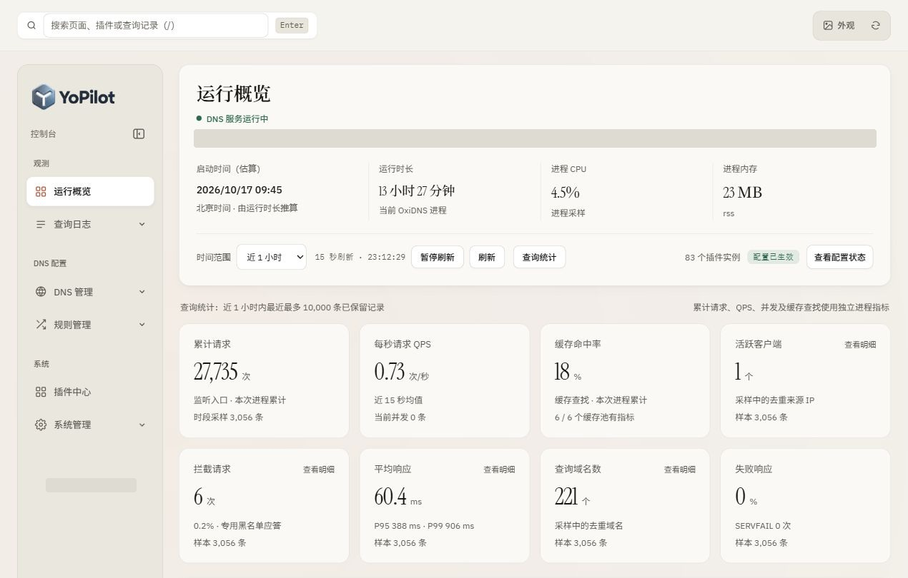
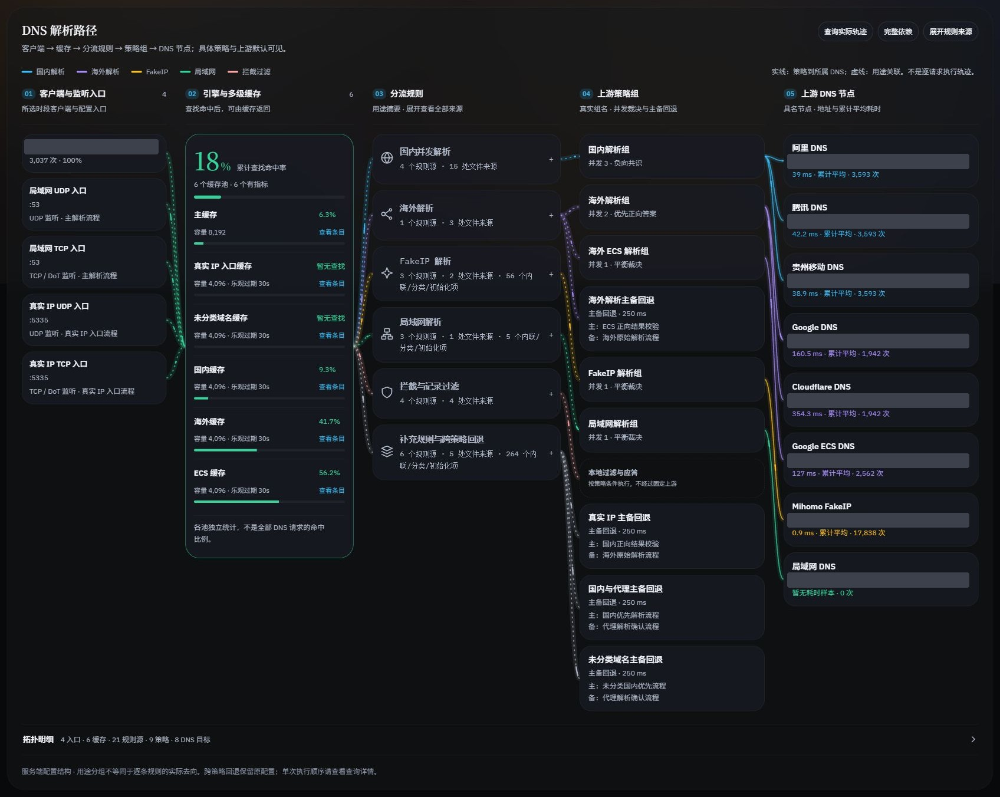
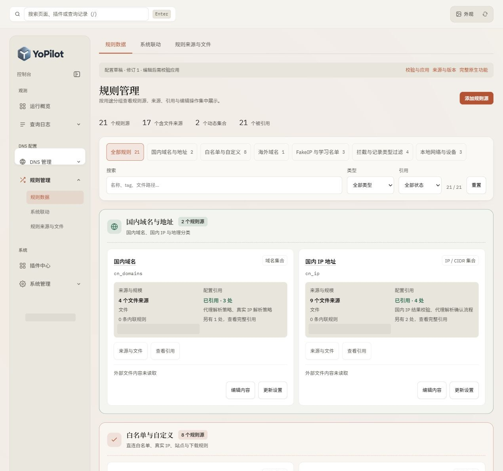
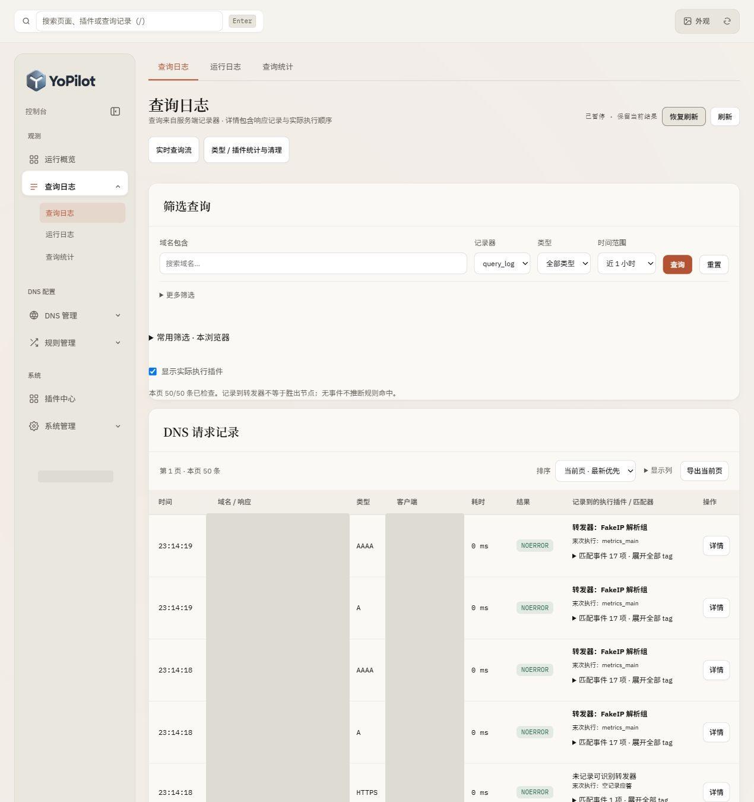
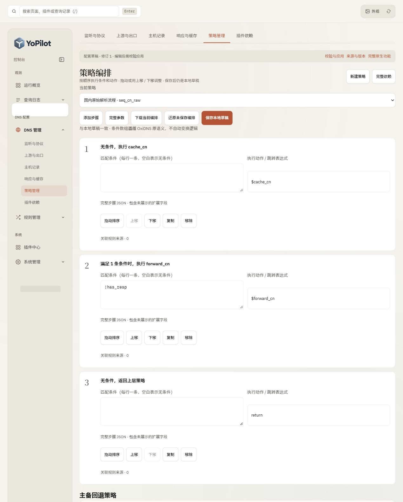
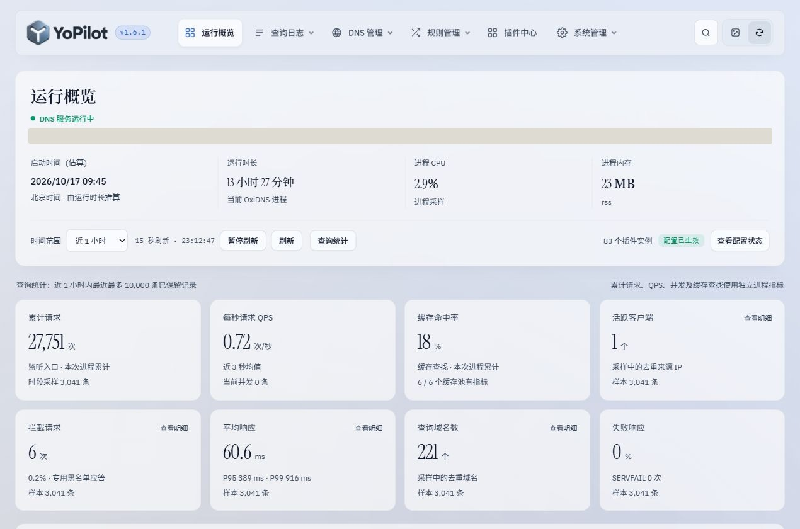

<picture>
  <source media="(prefers-color-scheme: dark)" srcset="assets/yopilot-brand/yopilot-metal-dark.png">
  
</picture>

# YoPilot

面向 OxiDNS 的中文 DNS 管理前端：以运行概览、五阶解析拓扑和用途分组，把现有插件与 API 组织成更直观的操作界面。

**只换 UI，不改 DNS 内核。** YoPilot 是静态 HTML / CSS / JavaScript，不需要编译或替换 OxiDNS，不新增管理后台，也不额外启动 DNS 服务。

当前版本：`0.1.0` · 已验证后端：`OxiDNS 1.6.1 full` · 许可证：`GPL-3.0-or-later`



## 能做什么

| 工作区 | 主要能力 |
| --- | --- |
| 运行概览 | 服务状态、进程资源、请求/QPS、缓存命中、采样客户端/域名数、拦截说明、耗时分位数、排行与趋势 |
| DNS 解析路径 | 客户端/监听 → 缓存 → 分流规则 → 策略组 → 上游 DNS；具名节点、实际累计耗时、关联高亮与查询入口 |
| DNS 管理 | 监听、上游/出口、本地记录、响应/缓存、策略编排、静态依赖；保留完整参数与未知字段 |
| 规则管理 | 规则源按用途归类；内联内容、文件来源、引用、下载/调度与动态学习集合分别管理 |
| 查询与日志 | 原生查询筛选/游标翻页、DNS 响应与执行事件、常用筛选、采样统计、实时查询/运行日志流 |
| 系统与运维 | 配置草稿/校验/版本保护应用、本浏览器配置历史、分类维护、任务与原生运行控制入口 |
| 外观 | 羊皮纸与毛玻璃双皮肤、明暗切换、垂直/水平导航、侧栏折叠、Dock 放大、字体/圆角/动效设置 |

完整功能与限制：[功能说明](docs/FEATURES.md) · [架构与数据语义](docs/ARCHITECTURE.md)

## 功能截图

截图来自实际界面。公开图片对服务地址、客户端、查询域名等信息作了脱敏，不包含生产配置原文或登录凭据。

### 五阶 DNS 解析拓扑



### 规则用途分组



### 查询筛选与执行事件



### 条件与动作策略编排



### 毛玻璃与手机布局



更多截图及范围说明：[截图画廊](docs/SCREENSHOTS.md)。

## 快速开始

### 已有 OxiDNS

1. 确认已有 OxiDNS 管理 API / WebUI，并备份现有 WebUI 静态目录。
2. 取得本仓库的静态前端包，或将 `web-assets.json` 列出的文件复制到现有 WebUI 目录。
3. **保留原有 `_next/` 等原生资源及原生页面，不要清空目录。** 首次替换首页前，将原 `index.html` 另存为 `native.html`。
4. 从原管理地址打开 YoPilot。默认使用当前页面同源 API；原生认证设置保持不变。

只发布静态文件通常不需要重启 DNS。不要仅为了更新 YoPilot 而重启、重载配置或清缓存。

需要交互式 SSH 部署或完整回退步骤，见 [安装与回退](docs/INSTALL.md)。部署脚本没有内置设备地址、密码或自动重启命令。

### 本地查看源码与界面

```sh
git clone https://github.com/yyhoworks/YoPilot.git
cd YoPilot
python -m http.server 8765 --bind 127.0.0.1
```

打开 `http://127.0.0.1:8765/`。这是静态预览服务，不是 DNS 后台。可在“服务连接”选择示例模式；连接实际 API 时需填写自己的地址，并满足原生 API 的认证和 CORS 要求。

仓库中的示例地址使用 RFC 5737 文档网段，不是可直接连接的公共 DNS 配置。不要将示例草稿应用到生产。

## 能力边界

- 插件目录包含核对快照中的 **65 种类型、247 个顶层字段定义**，不代表所有平台/编译特性/参数组合均完成生产写入验收；实际可用类型以 `/api/build` 为准。
- 原生查询统计最多采样所选时段最近 **10,000 条已保留记录**，不是无限历史数据库聚合。单条记录仍使用原生游标分页。
- 用途分组和配置连线不是逐请求路径；实际执行以记录器事件为准。“相关查询”仅关联当前读取页的已记录 tag。
- 不伪造原生接口没有提供的单步骤耗时、精确命中表达式或最终胜出 DNS 节点。
- 不提供任意外部规则/include 文件的在线读写。内联规则、动态集合、文件来源路径和下载任务各按原生能力管理。
- 表单保存首先进入浏览器草稿，不等于运行生效。运行时动态集合、缓存和清理操作是另一类真实写操作，需单独确认。
- 保留原生高级管理入口；本项目不包含 OxiDNS 安装器、服务端程序、数据库、规则订阅或额外认证后台。

## 开发与验证

运行时不需要 Node.js 或 npm。Node.js 22+ 仅用于开发测试；Python 3.10+ 可用于静态打包，SSH 部署另需 `paramiko`。

```sh
npm test
npm run check
npm run package
```

`dist/yopilot-webui-v0.1.0.zip` 仅包含静态文件与许可证，不包含后端或运行配置。提供[可选 GitHub Actions 模板](docs/examples/frontend-check.yml)，可运行相同检查并生成静态包 artifact；本次发布未启用云端工作流。

[开发说明](docs/DEVELOPMENT.md) · [更新记录](CHANGELOG.md) · [安全说明](SECURITY.md)

## 来源与许可

OxiDNS 插件定义来自 [svenshi/oxidns](https://github.com/svenshi/oxidns)；视觉参考来自维护者提供的 [LocalDNS](https://github.com/yyhoworks/LocalDNS) 设计。YoPilot 是独立前端项目，不是 OxiDNS 官方发行版。

主项目采用 GPL-3.0-or-later；js-yaml、字体与品牌说明见 [第三方声明](THIRD_PARTY_NOTICES.md)。
